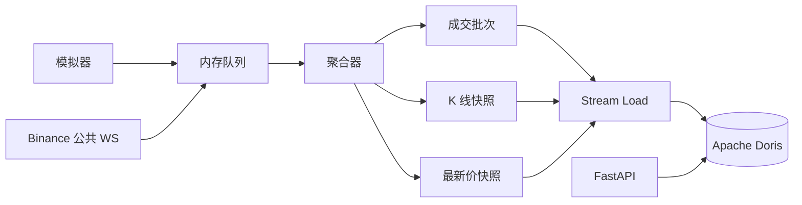

# 基于 Apache Doris 的行情系统

本文描述 `market-data-doris-demo` 的设计。它是一个可以跑起来的最小行情链路：从交易所或模拟器接收逐笔成交，在进程内收成 K 线和最新价，用 Stream Load 写入 Doris，再由 HTTP API 查询。

它不是交易系统，没有订单簿、撮合和风控。目标是把「行情数据为什么适合放进 Doris、表应该怎么建、写入和查询怎么分工」讲清楚，并用同一套代码验证。

## 1. 目标

- 接入至少一种真实公开行情（Binance 逐笔成交），以及一个不依赖外网的模拟源。
- 落三类数据：逐笔成交、多周期 K 线、每个交易对一行最新价。
- K 线在形成过程中可以被覆盖更新，重复导入同一笔成交不会让成交量翻倍。
- 查询侧提供最新价、K 线、最近成交，并给出由 K 线回算的 24 小时统计。
- 单机 Docker 即可运行，不引入 Kafka。

不在本次范围内的内容见第 11 节。

## 2. 总体架构



进程分成两条独立命令，方便单独重启：

| 命令 | 职责 |
| --- | --- |
| `python -m market_data init` | 执行 `sql/001_schema.sql`，建库建表 |
| `python -m market_data collect` | 采集、聚合、写入 |
| `python -m market_data serve` | 只读查询 API |

采集进程是唯一的写入方。API 进程只发 `SELECT`。两边都通过 MySQL 协议或 HTTP 直连 Doris，彼此不通信。这样 API 重启不会打断采集，采集重启也不会把查询进程里的连接状态弄乱。

选择在应用侧聚合 K 线，而不是把逐笔丢给 Doris 再 `GROUP BY`，有三个原因：

1. 正在形成的那根柱子需要大约每秒更新一次。先在内存里收成一行，再整行 upsert，写入量是「交易对 × 周期」，不是逐笔。
2. K 线的开盘价必须是该周期内第一笔的价格，收盘价必须是最后一笔的价格。乱序到达时，这个语义在内存里用两枚时间戳就能维持，SQL 聚合要额外保留首尾成交。
3. 查询路径因此只扫 `md_kline`。画图接口的延迟和数据量可预期。

Doris 仍然保存原始逐笔。需要复核某根 K 线时，用 `sql/queries.sql` 里的语句按时间窗口重算即可。

## 3. 为什么用 Doris

行情写入有两种形态，Doris 的表模型刚好对应上：

| 数据 | 写入形态 | 表模型 |
| --- | --- | --- |
| 逐笔成交 | 追加，但重试不能产生第二笔 | Unique Key，Merge-on-Write |
| 正在形成的 K 线 | 同一主键反复覆盖 | Unique Key，Merge-on-Write |
| 最新价 | 每个交易对永远只有一行 | Unique Key，Merge-on-Write |

Merge-on-Write 在导入时就按主键合并，查询不用再叠一层 delete bitmap 才能看到最新值。K 线和最新价都是点查或短范围扫描，这个特性比 Merge-on-Read 合适。Doris 2.1 起 Unique 表默认就是 Merge-on-Write，建表语句里仍显式写上 `enable_unique_key_merge_on_write`，避免连到 2.0 集群时退回旧实现。

另外两个用得上的能力：

- **MySQL 协议**。查询服务用普通 SQL 和参数绑定即可，不需要单独的查询引擎。
- **Stream Load**。一批 CSV 一次 HTTP 导入，整批原子：要么全部可见，要么整批失败。比逐行 `INSERT` 适合持续写入。

如果逐笔吞吐高到 Merge-on-Write 的主键合并成为瓶颈，可以把 `md_trade` 单独改成 Duplicate Key，在采集端保证不重试已成功的批次。K 线和最新价仍然保持 Unique Key。这是预留的退路，demo 不走这条路，因为正确性比极限吞吐重要，而且 Unique Key 让「失败后整批重放」变得安全。

## 4. 逻辑模型

内部只认一种标准交易对：`BASE-QUOTE`，大写。本 demo 的两只品种是 `BTC-USDT` 和 `ETH-USDT`，计价资产都是 USDT。Binance 的 `BTCUSDT`、`ETHUSDT` 在边界上转换成这两个名字，表里不会同时出现带连字符和不带连字符的两种写法。

成交（`Trade`）字段：

| 字段 | 含义 |
| --- | --- |
| exchange | `binance` 或 `simulator` |
| symbol | 标准交易对 |
| trade_id | 交易所成交号。模拟器使用进程内递增序号 |
| trade_time | 成交时间，UTC，毫秒 |
| price / qty | `Decimal`，禁止用二进制浮点穿越整条链路 |
| side | taker 方向。Binance 的 `m=true` 表示买方是 maker，因此 taker 是 `sell` |

K 线周期固定为 `1m`、`5m`、`15m`、`1h`、`4h`、`1d`，全部按 UTC 对齐。`4h` 落在 00:00、04:00、08:00、12:00、16:00、20:00。不跟随交易所的自然日，避免同一张表里出现两种日切。

最新价表里的开高低收和成交量是**本采集进程启动以来**的累计值。进程重启后这些字段重新起算。滚动 24 小时统计不放进这张表，避免在写入路径上维护一个滑动窗口；查询时从 `md_kline` 的 1 分钟柱子求和。

## 5. 物理表设计

建表语句在 `sql/001_schema.sql`。三张表都在库 `market_data`。

### 5.1 排序键

Doris 的前缀索引就是排序键的前 36 字节，没有二级 B-Tree。排序键必须按真实过滤条件来排。

行情查询几乎总是「某个交易所的某个交易对，再加时间范围」：

```sql
WHERE exchange = ? AND symbol = ? AND timeframe = ? AND open_time >= ?
```

因此排序键把 `exchange, symbol` 放在最前面，时间列放在后面。分区列 `trade_time` / `open_time` 必须是 Key 的一部分，但不必是第一列，所以仍然可以按交易对做前缀过滤。

`md_ticker` 的主键就是 `(exchange, symbol)`，一行一个交易对。

### 5.2 分区

`md_trade` 和 `md_kline` 按天做动态分区：

- 提前建未来 3 天，保留过去 7 天。
- 建表时补最近 3 天的历史分区，避免刚启动就写进不存在的分区。
- 单节点 demo 不保留更长历史。生产把 `dynamic_partition.start` 加大，或把更老的分区转到对象存储，表结构不用改。

`md_ticker` 不分区。行数等于交易对数量，分区只会增加空 tablet。

动态分区带来的直接约束：写入时间必须落在已存在的分区里。采集端使用交易所时间，正常情况下就是「今天」。模拟器也使用当前 UTC 时间。

### 5.3 分桶

两张事实表都是 `DISTRIBUTED BY HASH(symbol) BUCKETS 4`。同一个交易对的成交和 K 线落在同一分桶规则下，以后如果要按交易对把两张表做 Colocate Join，桶数已经对齐。demo 没有建 colocate group，因为动态分区表对分区边界的一致性要求更严，不值得在第一次建表时冒险。

这个选择有一个明确的代价：单个热点交易对的全部写入只进一个 tablet，无法靠加桶来并行写同一个 symbol。demo 的量级（每个交易对每秒几笔到几十笔）远低于单个 tablet 的写入能力。真到了全市场逐笔的程度，成交表应改为按 `(symbol, 小时)` 分桶，或者改成 Duplicate + Random 分布，用分区和排序键保证查询裁剪，而不是指望一个 symbol 打散到所有 BE。

桶数的经验值是让一个 tablet 落在 1 GB 到 10 GB。demo 每天的数据量远小于 1 GB，4 个桶只是为了让执行计划里看得到分桶，不是容量规划。

### 5.4 类型和压缩

- 价格和数量用 `DECIMAL(38, 18)`。整数部分仍有 20 位，够用；小数部分覆盖链上和长尾币的常见精度。JSON 对外也用十进制字符串，避免再变成 float。
- 时间用 `DATETIME(3)`，保留毫秒。同一秒内的多笔成交不会在时间列上粘成同一时刻。
- 压缩用 `zstd`。行情列的重复度高，压缩比比默认 LZ4 更重要，demo 的 CPU 开销可以忽略。
- 副本数写死为 1，和 all-in-one 镜像一致。生产改为 3。

没有建 Bloom Filter。过滤列已经在排序键前缀里，再加 Bloom Filter 只增加写入开销。

## 6. 写入路径

### 6.1 采集

`collect --source` 二选一：

- `simulator`：几何随机游走，价格步进用整数基点，种子固定则可复现。默认只采集 `BTC-USDT` 和 `ETH-USDT`。
- `binance`：连接 `wss://stream.binance.com:9443/stream?streams=<symbol>@trade/...`。断线后等待 2 秒重连。不需要 API Key，只用公共成交流。

Binance 组合流的消息套在 `data` 里，解析器两种都接受。

### 6.2 聚合

聚合器是单线程所有权的内存结构，由一把锁保护。每来一笔成交：

1. 更新该交易对的 ticker。进程内第一笔看到的价格决定 `open_price`，之后只抬高 `high`、压低 `low`、累加量。`last_price` 只接受成交时间更晚的更新，乱序不会把最新价写回去。
2. 对每个周期计算桶起始时间 `epoch - epoch % width`，更新对应柱子。
3. 柱子内部用 `first_trade_time` 和 `last_trade_time` 决定 open 和 close，high / low 与顺序无关。

每根柱子带一个版本号。刷新时把脏柱子做浅拷贝和版本一起送去写入；写入成功后，只有版本号没变的柱子才清掉脏标记。刷新期间新到的成交会把版本加一，不会被这次确认误清。

已经收盘、已经成功写入、并且超过 120 秒的柱子从内存删掉。120 秒是给轻微乱序留的窗口。更晚的成交会按「只有这一笔」重新开一根柱子并覆盖 Doris 里的正确值，这是 demo 接受的边界。生产上要嘛保留更久，要嘛用交易所的已完成 K 线做对账修正。

### 6.3 Stream Load

默认每秒刷新一次。成交、K 线、最新价分三次导入，各自原子。

```text
PUT http://{fe}:8030/api/market_data/{table}/_stream_load
format: csv
strict_mode: true
max_filter_ratio: 0
```

FE 通常返回 307，把请求重定向到 BE 的 8040。客户端不自动跟随重定向，而是把重定向里的主机改写成 `DORIS_BE_HOST`（默认 `127.0.0.1`），端口改写成公布出来的 `8040`。Docker Desktop 上 FE 给出的 BE 地址在容器网段里，宿主机访问不到；端口映射之后，改写主机是能工作的做法。Linux 上如果宿主机能直接路由到 BE，把 `DORIS_BE_HOST` 配成 BE 的真实地址即可。

认证在重定向后仍然带上。`requests` 默认会在跨主机重定向时丢掉 Authorization，这里关掉这个行为。

一次刷新的确认规则：

- 某张表导入成功，才从内存缓冲区丢掉对应快照。
- 失败则整批留在内存里，下一轮一起重放。Unique Key 保证成交和 K 线重放不会重复计数。
- 三张表独立确认。成交成功、K 线失败时，只重放 K 线。
- 成交缓冲区超过 10 万条仍写不进去时丢掉最旧的，避免 Doris 长时间不可用把进程撑满。丢弃会打错误日志。

`Status=Success` 和 `Publish Timeout` 都视为成功。后者表示事务已提交，只是发布超时，数据随后可见。

### 6.4 时间与幂等

主键是 `(exchange, symbol, trade_time, trade_id)`。同一笔成交只要这四列不变，价格和数量被覆盖成相同的值。`ingest_time` 会更新成最近一次写入时间，不参与主键，也不参与任何累加。

K 线主键是 `(exchange, symbol, timeframe, open_time)`。每次写入的都是这根柱子的完整当前值，不是增量。因此重放旧快照不会在已有量上再加一遍；如果旧快照比内存里的新版本先到达，新版本随后会再覆盖一次。刷新间隔内最多出现一次短暂的旧值，下一次成功写入即纠正。

## 7. 查询服务

FastAPI 进程，默认 `:8000`。交互式文档在 `/docs`。

| 方法 | 路径 | 说明 |
| --- | --- | --- |
| GET | `/health` | `SELECT 1`，Doris 不可达时返回 503 |
| GET | `/api/v1/symbols` | 读 `md_ticker` 的交易对列表 |
| GET | `/api/v1/ticker` | 一行最新价，并附上由 1 分钟 K 线计算的 24h 高低量、开盘价和涨跌幅 |
| GET | `/api/v1/klines` | 最近 N 根 K 线，按时间正序返回，N 最大 1000 |
| GET | `/api/v1/trades` | 最近 N 笔成交，默认只看过去 24 小时 |

24 小时统计的算法：

```text
high_24h / low_24h / volume_24h = 过去 24 小时 1m 柱子的 MAX / MIN / SUM
open_24h = 这个窗口内第一根 1m 柱子的 open
change_24h_pct = (last_price - open_24h) / open_24h * 100
```

窗口起点在应用侧用 UTC 算出后作为参数传入，不依赖 FE 的时区。

`timeframe` 只允许第 4 节的六个值。`symbol` 必须匹配 `BASE-QUOTE`，`exchange` 必须是小写字母或数字。这些检查在拼 SQL 之前完成，条件值全部走参数绑定。

K 线查询用 `ORDER BY open_time DESC LIMIT ?` 再在应用侧反转。这样「最近 200 根」不必先数全表。

每次请求新建一条 MySQL 连接。demo 的 QPS 不需要连接池；真要对外服务时，换成池化连接即可，SQL 不用改。

## 8. 失败语义

| 场景 | 行为 |
| --- | --- |
| Binance 断线 | 采集协程等待 2 秒后重连，内存中的柱子还在 |
| Stream Load 失败 | 该表的快照留在内存，下个周期重放 |
| 进程在两次刷新之间退出 | 最多丢失一个刷新间隔的数据，默认 1 秒 |
| 进程重启 | ticker 的进程内累计值重新开始；Doris 里已提交的成交和 K 线还在。重启后新柱子会从新成交重新累加，并覆盖同一主键 |
| 乱序超过 120 秒 | 可能用残缺柱子覆盖已正确的 K 线 |
| 缓冲区超过 10 万条 | 丢弃最旧成交，日志报错 |

没有做跨进程的 exactly-once。在这个系统里，Unique Key 把「至少一次 + 整行覆盖」收成了查询侧可接受的结果：成交不重复计数，K 线最终等于最后一次成功写入的完整快照。

## 9. 容量和延迟的数量级

按每个交易对每秒 10 笔估算：

| 规模 | 成交行 / 天 | 1 分钟 K 线 / 天 |
| --- | --- | --- |
| 3 个交易对（demo） | 约 260 万 | 约 4 千 |
| 100 个交易对 | 约 8600 万 | 约 14 万 |

100 个交易对、每秒 10 笔，对单机 Doris 仍然宽裕。K 线写入量大约是「交易对数 × 6 个周期 × 每秒 1 次」，每秒几百行。

查询延迟的大头是一次 Stream Load 的发布周期，加上最多 1 秒的刷新间隔。端到端从成交到 API 可见，正常在 1 到 3 秒。这是行情看板的延迟，不是做市所需的微秒级延迟。微秒级路径不应该绕 Doris。

## 10. 运行

依赖：

- Docker Desktop，内存建议不少于 6 GB
- Python 3.10+

```powershell
docker compose up -d
# 等到 healthy。镜像第一次拉取大约 2.7 GB。
docker inspect --format "{{.State.Health.Status}}" market-data-doris

python -m pip install -e ".[dev]"
copy .env.example .env
python -m market_data init
```

采集和查询分两个终端。`--symbols` 的默认值就是 `BTC-USDT,ETH-USDT`：

```powershell
python -m market_data collect --source simulator --rate 5
python -m market_data serve
```

真实行情同样使用这两个默认交易对：

```powershell
python -m market_data collect --source binance
```

查询：

```powershell
curl.exe "http://127.0.0.1:8000/api/v1/ticker?exchange=simulator&symbol=BTC-USDT"
curl.exe "http://127.0.0.1:8000/api/v1/klines?exchange=simulator&symbol=ETH-USDT&timeframe=1m&limit=20"
```

Doris 镜像是 `apache/doris:all-in-one-4.1.3`。要换版本时设置 `DORIS_IMAGE` 再 `docker compose up`。FE 查询端口 9030，FE HTTP 8030，BE HTTP 8040，用户 `root`，密码为空。这是开发镜像，不是生产部署：单副本、资源被调小、`docker compose down` 会丢掉容器里的数据。

## 11. 不在本次范围

- 订单簿和深度。深度是快照加增量，主键和合并语义与逐笔不同，单独一张表才说得清楚。
- 多交易所的时钟对齐、资金费、标记价格。
- Kafka 与 Routine Load。生产上采集进程不应直接对 Doris 做同步 HTTP，应先落消息队列。表结构和 API 不用改，替换的是 `writer`。
- 用户、鉴权和多租户。
- 历史回补。现在只有实时流；回补交易所 REST K 线时直接写 `md_kline`，主键相同，实时柱子会在下一笔成交后把未收盘的那根重新覆盖正确。
- 前端页面。`/docs` 足够验证查询。

## 12. 代码布局

```text
docs/design.md          本文
sql/001_schema.sql      建表
sql/queries.sql         手工核对用的 SQL
docker-compose.yml      单节点 Doris
src/market_data/
  cli.py                init / collect / serve
  pipeline.py           采集循环、成交缓冲、刷新和确认
  aggregator.py         K 线与 ticker 的内存状态
  simulator.py          模拟成交
  binance.py            公共成交流解析与连接
  stream_load.py        Stream Load 与重定向改写
  writer.py             三张表的 CSV 行
  doris.py              建表与查询
  api.py                HTTP 接口
  serialize.py          价格用十进制字符串输出
  models.py             Trade、周期表
tests/                  不依赖 Doris 的单元测试
```

聚合、CSV、Binance 报文、重定向改写和建表脚本切分都有单元测试。这些部分决定数据对不对，而且不需要启动 Doris。
